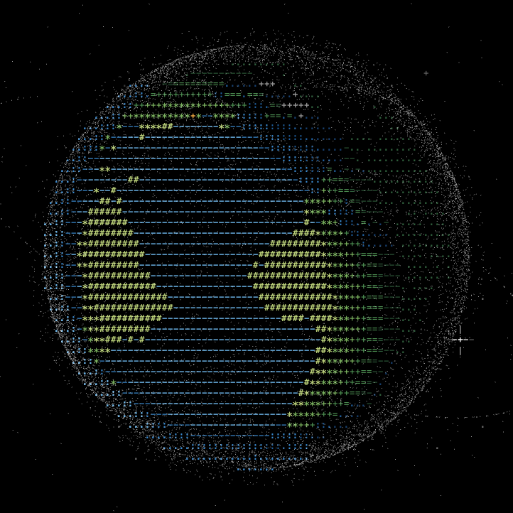

# ascii-earth-forecast

Daily weather and satellite position forecasts, scored against the past week. The output drives the clouds, rain and satellites on the ASCII planet at [nas01010101.github.io](https://nas01010101.github.io) and its [flow page](https://nas01010101.github.io/flow.html).



## Data flow

```
weather                                satellites

Open-Meteo forecast API                CelesTrak active elements
1,152 cells on a 7.5 degree grid       one CSV snapshot a day
  |                                      |
  v                                      v
validate                               validate
ranges, shape, under 1% missing        header, row count, drops rows
                                       SGP4 cannot read
  |                                      |
  v                                      v
preprocess                             preprocess
UTC daily means, departures            match by NORAD id, keep objects
from each cell's trailing mean         with newer elements
  |                                      |
  v                                      v
train                                  predict
ridge regression per latitude band     SGP4 from elements 1 to 7 days old,
                                       ridge fit of along-track drift
  |                                      |
  v                                      v
predict                                actual
today, from the days through           SGP4 from today's elements,
yesterday                              at their epoch
  |                                      |
  v                                      v
score                                  score
last 7 days, area-weighted MAE,        distance in km, by orbit and age
against persistence and trailing mean
```

## Scoring

- **Weather.** Cloud cover and 2 m temperature. Each scored day is predicted by a model trained only on earlier days, and is predicted again on each run from the stored days, so the table is a backtest of the method and not a record of maps published earlier. Baselines: yesterday's value (persistence) and the mean of the earlier days.
- **Satellites.** Elements published 1 to 7 days ago are propagated to the epoch of today's elements. The result is the median distance by orbit regime, plus the ISS. The drift correction is fitted on the pair ending yesterday and never sees today's elements.

"Actual" is a public reference with its own error, which these scores do not include. For weather it is Open-Meteo's model output for past hours, not station readings. For satellites it is SGP4 run from the newest published elements, not a tracking measurement.

The satellite table starts empty. It gains one horizon a day as snapshots accumulate.

## Output

A GitHub Actions job runs once a day and force-pushes the `data` branch, which holds a single commit:

| File | Contents |
|---|---|
| `forecast.json` | scores, ASCII maps, per-source status, the weights and loss of each band (`weather.model`), and today's forecast globally and at three cells (`weather.today`) |
| `planet.bin` | cloud and rain grids every 3 hours for today and tomorrow, read by the planet |
| `sats.bin` | satellite elements for the browser |
| `history.npz` | up to 60 days of daily means |
| `elements/` | up to 9 daily element snapshots |

If one source fails, its last good section stays in `forecast.json` and `status` records the failure and the date of that section. This covers any exception in a source. The job exits non-zero only when both sources fail. Stored days are never rewritten; a day left out for missing data is requested again on the next run. Design decisions: [docs/design.md](docs/design.md).

## Run

```sh
pip install ".[test]"
python -m pytest
python -m forecast data
```

`python -m forecast data` writes to `./data`. The first run downloads 45 days of weather, about 3,900 billed Open-Meteo calls at 500 a minute.

## Sources

- Weather data by [Open-Meteo](https://open-meteo.com/), [CC BY 4.0](https://creativecommons.org/licenses/by/4.0/). The free API is for non-commercial use.
- Orbital elements by [CelesTrak](https://celestrak.org/NORAD/elements/).

Code: MIT.
