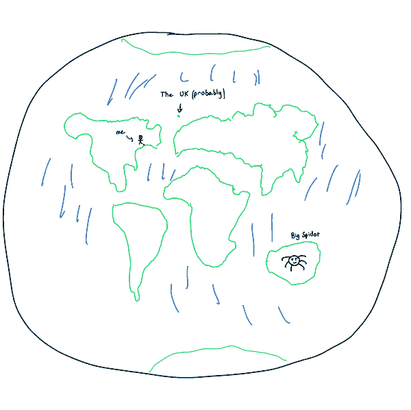

<p align="center"></p>

# ascii-earth-forecast

Daily forecasts of the world's weather and of where every active satellite will be, drawn as text on [a planet in the browser](https://nas01010101.github.io/earth.html).

[live page](https://nas01010101.github.io/earth.html) · [method](https://nas01010101.github.io/earth.html#method) · [data branch](https://github.com/Nas01010101/ascii-earth-forecast/tree/data)


| Forecast | Model | Scored against |
|---|---|---|
| cloud, temperature and pressure for today | U-Nets reading 30 days of 7 fields, run with numpy | repeating the day before |
| satellite positions 1 to 30 days ahead | SGP4 plus a residual network's correction | SGP4 alone |

## Data flow

```
weather                                satellites

Open-Meteo forecast API                CelesTrak active elements
1,152 cells on a 7.5 degree grid       one CSV snapshot a day
  |                                      |
  v                                      v
validate                               validate
ranges, shape, under 1% missing        header, row count, drops rows
                                       SGP4 cannot read
  |                                      |
  v                                      v
preprocess                             preprocess
7 fields: UTC daily means and          each object's element sets, oldest
6-hourly steps                         first, and 45 inputs from them
  |                                      |
  v                                      v
predict                                predict
cloud, temperature, pressure: U-Nets   SGP4 from elements 1, 3 and 7 days
reading 30 days, frozen; ridge for     old, plus a residual network: 6
cloud and temp if days are missing     blocks, 256 wide, mean of 3, frozen
  |                                      |
  v                                      v
actual                                 actual
the stored daily means, once the day   SGP4 from the first newer set past
has finished                           the horizon, at its epoch
  |                                      |
  v                                      v
score                                  score
kept forecasts, last 28 days, area-    median distance in km, against
weighted squared error, against        SGP4 alone
repeating the day before
```

## Scoring

- **Weather.** Each run keeps that day's forecast of cloud cover, 2 m temperature and pressure in `forecasts.npz`, and `weather.losses` scores the kept forecasts of the last 28 finished days against what happened and against repeating the day before. The loss is the area-weighted squared error. A row has `issued: true` when the forecast was kept on the day it was made and `issued: false` when it was replayed from stored days because no forecast was kept then, and `net: true` when the network made its cloud map rather than the ridge. A replay uses only earlier days, and a kept forecast is never rewritten.
- **Satellites.** Each day, `satellites.losses` scores the forecasts that started 1, 3 and 7 days earlier: the median distance in km of SGP4 alone and of SGP4 with the network's correction. A forecast reads only the element sets held when it started. A row has `issued: true` when it was scored on its own day and `issued: false` when it was replayed from stored snapshots after a missed run.

"Actual" is a public reference with its own error, which these scores do not include. For weather it is Open-Meteo's model output for past hours, not station readings. For satellites it is SGP4 run from the newest published elements, not a tracking measurement.

## Weather network

`forecast/cloudnet.py` runs a U-Net with numpy from `forecast/cloud_weights.npz`: 5,114,817 weights, stored as 16-bit floats. It reads 7 fields over the past 30 days (cloud, temperature, rain, pressure, wind east and north, water vapour) and predicts the day's mean cloud cover. Training and evaluation code is in `research/weather`, on ERA5 from WeatherBench 2: trained on 1979 to 2018, checked on 2019 and 2020, tested on a sealed 2021 and 2022.

| Test | Cloud loss | Below the ridge |
|---|---|---|
| Sealed ERA5 holdout, 2021 and 2022 | | 48.48% (standard error 0.38) |
| 28 stored Open-Meteo days, 2026-10-07 to 2026-11-03, network | 374.3 | 18.0% |
| Same days, ridge | 456.3 | |
| Same days, repeating the day before | 647.0 | |
| Same days, Open-Meteo's own forecast made a day earlier | 172.1 | |

The Open-Meteo forecast is a reference and not a fair bar: it is scored against output of the same system. The gap between 48% and 18% is not fully explained. The stored days are point values at 7.5 degree cells and the network trained on ERA5's 1.5 degree area means, and the Open-Meteo fields have a wider spread than ERA5's (cloud standard deviation 1.36 times ERA5's), with no sign of a unit error. `weather.losses` is the test of the kept forecasts.

`forecast/temp_weights.npz` and `forecast/pressure_weights.npz` hold three U-Nets each, 1,294,049 weights per network, reading the same 7 fields over the same 30 days. Each was trained on ERA5, then fine-tuned on 30 Open-Meteo days from 2026-07-18, stopping on the next 15. A forecast is the mean of the three. The weights are the ones scored below, not refit on the test days.

| Test against the ridge fed 24-hour means | Temperature | Pressure |
|---|---|---|
| Sealed Open-Meteo days, 2026-10-07 to 2026-11-03 | 61.42% below | 62.99% below |
| Selection days, 2026-09-01 to 2026-10-06 | 64.36% below | 63.60% below |
| Selection days, Open-Meteo's own forecast made a day earlier | 89.72% below | not fetched |

The mean of both fields on the sealed days is 62.20% below the ridge, standard error 0.75.

## Satellite network

`forecast/drift.py` runs the network with numpy from `forecast/drift_weights.npz`. Training and evaluation code is in `research/sat`, on public element sets from 2017 to 2025.

| Test, with weights trained through 2024 on the 2025 catalogue | 15-day improvement over SGP4, mean of objects' medians | 95% interval |
|---|---|---|
| Sealed holdout, every published set | 30.21% | 24.85 to 34.46 |
| Same year, sets as a once-a-day job holds them | 28.8% | 24.25 to 32.39 |

On the three objects of [Liu et al. 2021](https://doi.org/10.26077/aspb-yk57), a network from the same recipe trained on 2017 and 2018 improved the 15-day miss by 21.04% (13.23 to 27.54) from 2019 to mid 2020. The mean of that paper's 15-day table is 29.3%, and it describes no separate test period. The catalogue numbers are a different test and do not compare with it.

`research/sat/replay_check.py` runs the daily job's scorer on 47 weekly days of 2025, on an eighth of the catalogue, with the weights trained through 2024:

| Days ahead | Days the network beat SGP4 | Median miss, SGP4 | Median miss, network |
|---|---|---|---|
| 1 | 32 of 47 | 0.77 km | 0.70 km |
| 3 | 45 of 47 | 2.95 km | 2.33 km |
| 7 | 46 of 47 | 11.34 km | 6.76 km |

Truth is SGP4 from a later published element set, not tracking data. Manoeuvres are not filtered out. The weights in this repository were refit on every labelled year through 2025, so they have no held-out test of their own; `satellites.losses` is theirs.

## Output

A GitHub Actions job runs once a day and force-pushes the `data` branch, which holds a single commit:

| File | Contents |
|---|---|
| `forecast.json` | per-source status, today's ASCII map, its forecast at three cells and the model that made it (`weather.today`), the last finished day's map (`weather.last_scored`), the loss of past forecasts (`weather.losses`), and the satellite loss (`satellites.losses`) |
| `planet.bin` | cloud and rain grids every 3 hours for today and tomorrow, read by the planet |
| `sats.bin` | satellite elements for the browser |
| `history.npz` | up to 60 days of daily means |
| `steps.npz` | 38 days of the 7 fields, every 6 hours, read by the network |
| `forecasts.npz` | every forecast kept so far, by day, with its `issued` and `net` flags |
| `elements/` | up to 38 daily element snapshots |

If one source fails, its last good section stays in `forecast.json` and `status` records the failure and the date of that section. This covers any exception in a source. The job exits non-zero only when both sources fail. Stored days are never rewritten; a day left out for missing data is requested again on the next run. Design decisions: [docs/design.md](docs/design.md).

## Run

```sh
pip install ".[test]"
python -m pytest
python -m forecast data
```

`python -m forecast data` writes to `./data`. The first run downloads 45 days of weather, about 3,900 billed Open-Meteo calls at 500 a minute.

## Sources

- Weather data by [Open-Meteo](https://open-meteo.com/), [CC BY 4.0](https://creativecommons.org/licenses/by/4.0/). The free API is for non-commercial use.
- Orbital elements by [CelesTrak](https://celestrak.org/NORAD/elements/).

Code: MIT.
