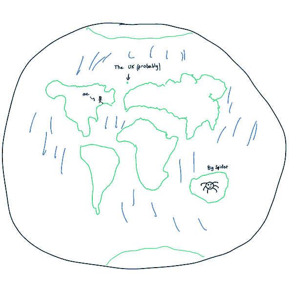
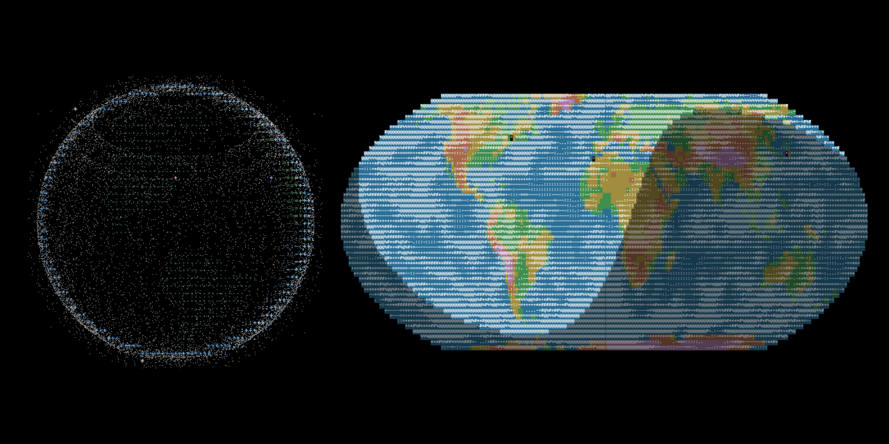

<p align="center"></p>

# ascii-earth-forecast

Daily forecasts of the world's weather and of where every active satellite will be, drawn as text on [a planet in the browser](https://nas01010101.github.io/earth.html).

[live page](https://nas01010101.github.io/earth.html) · [method](https://nas01010101.github.io/earth.html#method) · [data branch](https://github.com/Nas01010101/ascii-earth-forecast/tree/data)



| Forecast | Model | Scored against |
|---|---|---|
| cloud, temperature and pressure for today | U-Nets reading 30 days of 7 fields, run with numpy | repeating the day before |
| satellite positions 1 to 30 days ahead | SGP4 plus a residual network's correction | SGP4 alone |

## How it works

- **Weather.** Open-Meteo hourly fields on a 7.5 degree grid (1,152 cells) become UTC daily means and 6-hourly steps. Frozen U-Nets read the last 30 days of steps and forecast today's mean cloud cover, temperature and pressure; a ridge regression stands in for cloud and temperature when a day of steps is missing.
- **Satellites.** One CelesTrak snapshot of the active elements a day. SGP4 propagates each object, and a frozen residual network corrects its height, along-track and cross-track error from the object's own recent element sets.
- **Scoring.** Weather forecasts are kept and scored once their day has finished, by area-weighted squared error over the last 28 days. Satellite forecasts are scored by median miss in km at 1, 3 and 7 days, reading only the element sets held when they started. A day missed by the job is replayed from earlier stored data and marked `issued: false`. ECMWF's AIFS forecast is scored next to the weather networks as a reference.
- **Failures.** Each source fails on its own: its last good section stays in `forecast.json` and `status` records the error. Stored days are never rewritten, and a day left out for missing data is fetched again on the next run.

Training code is in `research/weather` and `research/sat`. Test results are in [docs/results.md](docs/results.md), design decisions in [docs/design.md](docs/design.md).

## Architecture

Three kinds of trained network run each day, all with numpy from frozen weights. The weather networks forecast today's daily mean; the satellite network corrects SGP4.

```
weather U-Net (forecast/cloudnet.py)

input  62 channels on the 24 x 48 grid (7.5 degrees)
       7 fields x (4 six-hourly steps of the last day + 3 daily means)   49
       30-day mean of cloud and temperature                               2
       land-sea mask, surface height, sin and cos latitude                4
       sin and cos day of year, the target's climatology                  3
       learned position channels                                          4
  |
down   residual block, halve, x4      24x48 -> 12x24 -> 6x12 -> 3x6
  |      cloud widths 64 128 256 256, temperature and pressure 32 64 128 128
up     double, concatenate the skip, residual block, x3   back to 24x48
  |
out    1x1 conv: the change from climatology + the 30-day anomaly

residual block: 3x3 conv, norm, GELU, 3x3 conv, norm, + 1x1 skip, GELU
longitude wraps around, latitude repeats its edge row
cloud: 1 network; temperature and pressure: mean of 3 each
```

```
satellite residual network (forecast/drift.py)

input  45 numbers per object and horizon
       11 from the current element set (mean motion, eccentricity,
          inclination, argument of perigee, perigee and
          apogee height, drag terms, updates in 30 days)
       24 from SGP4 hindcasts 1, 3, 7 and 15 days back (age, height,
          along-track and cross-track error, change in mean motion and drag)
       3 space-weather slots, held at zero
       horizon (2 forms), the object's own along-track drift, 4 missing flags
  |
       linear to 256
       6 x (layer norm, linear, GELU, linear, + skip)
       layer norm, linear to 4
  |
out    height, along-track and cross-track correction in km
       along-track = a x the object's own drift + b x its scale
       mean of 3 networks, added to the SGP4 position
```

## Run

```sh
pip install ".[test]"
python -m pytest
python -m forecast data         # one daily update into ./data
python -m forecast.check data   # exits 1 if the site could not read a file
```

The first run downloads 45 days of weather, about 3,900 billed Open-Meteo calls at 500 a minute; the AIFS download adds 1,152 a day and only warns when it fails. A GitHub Actions job runs the update twice a day, skips sources already done that day, and publishes `data/` with `scripts/data_branch.sh` as the single commit of the `data` branch.

## Published files

| File | Contents |
|---|---|
| `forecast.json` | per-source status; today's ASCII map, grids, forecast at three cells and the networks that made it (`weather.today`); the AIFS grids with model name and licence (`weather.today.aifs`); the last finished day's map (`weather.last_scored`); past forecast losses (`weather.losses`, `satellites.losses`) |
| `planet.bin` | header `<dHHHH` (start ms, frame count, hours per frame, rows, cols), then uint8 cloud percent and uint8 rain in tenths of a mm/h, every 3 hours for today and tomorrow |
| `sats.bin` | float64 base epoch in ms, then 8 float32 per satellite: epoch offset in seconds and 7 mean elements |
| `corrections.bin` | header `<10s2xII4H` (date, count, horizon count, horizons 1, 3, 7, 15 days), then int32 NORAD ids, int16 height, along and cross corrections in tenths of a km per horizon, and uint16 1-day misses of SGP4 and the network |
| `history.npz` | up to 60 days of daily mean cloud and temperature |
| `steps.npz` | 38 days of the 7 fields, every 6 hours, read by the networks |
| `forecasts.npz` | every forecast kept so far, by day, with its `issued`, `net` and `temp_net` flags and pressure |
| `aifs.npz` | AIFS daily means of cloud, temperature and pressure for the last 29 days |
| `elements/` | up to 38 daily element snapshots |

## Sources

- Weather data by [Open-Meteo](https://open-meteo.com/), [CC BY 4.0](https://creativecommons.org/licenses/by/4.0/). The free API is for non-commercial use.
- AIFS Single forecast by [ECMWF](https://www.ecmwf.int/), [CC BY 4.0](https://creativecommons.org/licenses/by/4.0/), served by Open-Meteo.
- Orbital elements by [CelesTrak](https://celestrak.org/NORAD/elements/).

Code: MIT.
